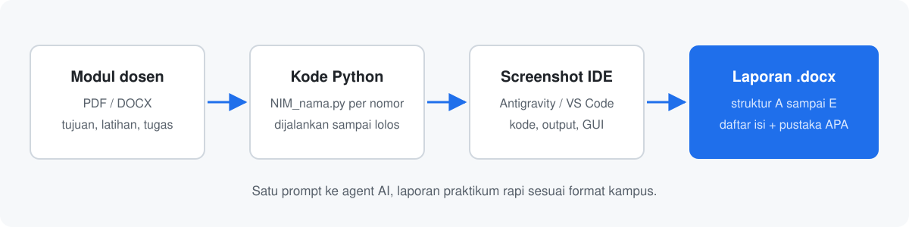
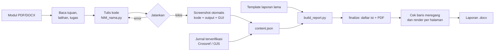
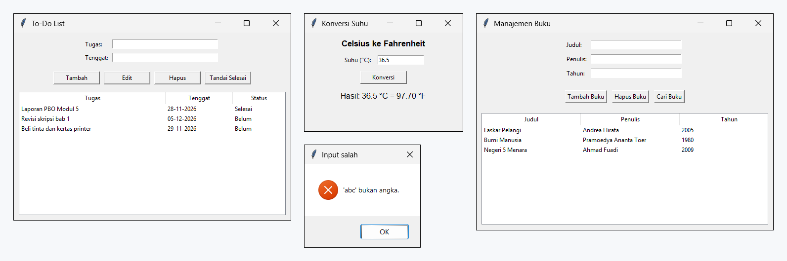

<div align="center">

**Bahasa Indonesia** · [English](docs/README_en.md)

# Laporan Praktikum

### Skill agent AI yang mengubah modul praktikum dari dosen menjadi laporan praktikum Word yang rapi.

**Lampirkan modul, sebut nama dan NIM. Kode, screenshot, dan laporan dikerjakan sampai siap diperiksa.**

[](https://github.com/bastiandoublen/laporan-praktikum/stargazers)
[](LICENSE)
[](SKILL.md)
[](#kebutuhan)
[](#kebutuhan)
[](#struktur-laporan)

[Mulai cepat](#mulai-cepat) · [Cara kerja](#cara-kerja) · [Fitur](#fitur) · [Showcase](#showcase) · [Struktur laporan](#struktur-laporan) · [FAQ](#faq) · [Kontribusi](#kontribusi)

<code>git clone https://github.com/bastiandoublen/laporan-praktikum</code>

</div>

> [!IMPORTANT]
> Laporan yang dihasilkan adalah **bantuan penyusunan**. Baca, pahami, dan jalankan sendiri kodenya sebelum
> dikumpulkan. Ikuti aturan kejujuran akademik di kampusmu.

<div align="center">

<br />



<br /><br />

</div>

---

Setiap minggu ada modul praktikum baru: salin tujuan, kerjakan latihan, screenshot kode satu per satu, tempel ke
Word, atur indent, ukuran gambar, daftar isi, dan daftar pustaka. Skill ini mengerjakan bagian yang berulang itu.

Agent membaca modul, menulis kode per nomor, menjalankannya, mengambil screenshot di **Antigravity IDE** atau
**VS Code** secara otomatis, lalu menyusun laporan dari template laporan lama dengan format yang konsisten. Jumlah
modul bebas: modul berikutnya cukup dilampirkan, laporan dibangun ulang dan penomorannya tetap rapi.

## Mulai cepat

### 1. Pasang skill

```powershell
git clone https://github.com/bastiandoublen/laporan-praktikum
pip install python-docx Pillow PyMuPDF
```

Agent yang mendukung format [Agent Skills](SKILL.md) bisa memakai folder hasil clone. Tambahkan folder itu ke lokasi skill sesuai petunjuk agent yang kamu gunakan.

### 2. Minta agent

```text
Kerjakan modul praktikum ini dengan template laporan yang saya lampirkan.
Nama: Nama Mahasiswa, NIM: 2025XXXXX. Kode simpan di C:\Users\saya\Documents\praktikum\pbo.
Pastikan daftar pustaka dari jurnal kampus ternama.
```

Agent akan mengonfirmasi rencana dulu, lalu bekerja. Saat screenshot berjalan, jangan sentuh keyboard dan mouse.

### 3. Tambah modul berikutnya

```text
Tambah modul 3 ke laporan, pengerjaannya sama dengan sebelumnya.
```

## Cara kerja



## Fitur

| | |
|---|---|
| **Kode per nomor** | File `NIM_nama.py` di `modulN/nomor_K` dan `tugas`, header `# Nama - NIM`, contoh dari modul disalin persis. |
| **Screenshot otomatis** | Kode per halaman dan output terminal di Antigravity IDE atau VS Code, dipotong per baris sesuai poin soal. |
| **Program `input()`** | Jawaban diketik otomatis, beberapa skenario (input kosong, nol, negatif) dalam satu capture. |
| **Aplikasi GUI Tkinter** | Jendela dan messagebox difoto langsung tanpa mengubah kode, bingkai Windows dibuang. |
| **Struktur laporan** | A. Tujuan, B. Alat dan Bahan, C. Landasan Teori, D. Kegiatan Praktikum, E. Tugas, poin latihan disalin dari modul. |
| **Daftar pustaka APA** | Sumber jurnal dicek ke halaman aslinya (penulis, volume, halaman, DOI), kutipan (Nama, tahun). |
| **Format rapi** | Indent bertingkat, gambar tepat 10 cm dengan border 1 pt, keep with next, tanpa baris meregang. |
| **Pengaman** | Berhenti kalau fokus pindah, ketikan nyasar ke editor, atau notifikasi ikut terfoto. |

## Showcase

<div align="center">

<br />
<sub>Jendela aplikasi Tkinter dari Modul 5 (GUI &amp; Collections), difoto otomatis oleh <code>gui_shot.py</code>.</sub>
</div>

<br />

<table>
<tbody>
<tr>
<td>
<h3>PBO Modul 1–5 dalam satu laporan</h3>
<p>Konsep dasar OOP, encapsulation, inheritance dan polymorphism, abstraction dan exception handling, sampai GUI
dengan Tkinter. 73 halaman, 257 gambar, daftar isi otomatis, 8 rujukan APA.
Isi lengkapnya ada di <a href="assets/contoh-content-pbo.json">assets/contoh-content-pbo.json</a>.</p>
</td>
</tr>
<tr>
<td>
<h3>Exception handling dengan banyak skenario</h3>
<p>Pembagian normal, penyebut nol, perkalian, input kosong, dan angka negatif dijalankan berurutan di terminal IDE
dengan jawaban otomatis, lalu difoto dalam satu gambar.</p>
</td>
</tr>
</tbody>
</table>

Sudah memakai skill ini untuk mata kuliah lain? Ceritakan di [issue](https://github.com/bastiandoublen/laporan-praktikum/issues)
dengan nama mata kuliah, bahasa pemrograman, dan hasilnya.

## Struktur laporan

```text
Modul 3. Inheritance & Polymorphism
A. Tujuan             1. 2. 3. (disalin dari modul)
B. Alat dan Bahan     Laptop, Antigravity IDE / VS Code, Python, GitHub
C. Landasan Teori     subjudul per konsep, kutipan (Nama, tahun)
D. Kegiatan Praktikum
   1. Inheritance
      a. Silahkan praktikkan contoh code di atas.   [kode utuh] [output]
      b. Buat class Person ...                     [potongan baris kode]
      ...
      g. Link GitHub                               [isian kuning]
E. Tugas              tiap poin soal + potongan kode, screen capture, analisis, link GitHub
DAFTAR PUSTAKA        APA, urut abjad, menggantung 1,27 cm
```

Analisis hanya ditulis di poin yang memang meminta analisis. Isian yang harus diisi sendiri (tanggal, jam, nomor
meja, link GitHub) diberi warna kuning.

## Isi repo

```text
SKILL.md                     panduan langkah demi langkah untuk agent
references/format-rules.md   aturan tampilan laporan
scripts/
  shot.ps1                   screenshot kode dan output di IDE (-Jawab, -NoRun, -Editor)
  ide_palette.ps1            perintah Command Palette (sticky scroll, revert, dsb.)
  editor.ps1                 deteksi Antigravity IDE / VS Code
  gui_shot.py                foto jendela Tkinter dan messagebox
  build_report.py            susun laporan .docx dari template + content.json
  finalize.ps1               perbarui daftar isi lewat Word dan ekspor PDF
  check_stretch.py           cari baris rata kiri-kanan yang meregang
  render_pages.py            render halaman PDF untuk dicek
  cek_notif.py               cari notifikasi Windows yang ikut terfoto
assets/contoh-content-pbo.json   contoh lengkap PBO Modul 1–5
```

## Kebutuhan

- Windows 10/11, monitor 1920x1080 (skala bebas)
- Microsoft Word (daftar isi dan PDF)
- Antigravity IDE atau [VS Code](https://code.visualstudio.com/) dengan perintah `code`
- Python 3.10+ dengan `python-docx`, `Pillow`, `PyMuPDF`
- Agent AI yang mendukung skill

## FAQ

<details>
<summary><strong>Apakah harus memakai Antigravity IDE?</strong></summary>

Tidak. Skrip memilih Antigravity kalau terpasang, selain itu VS Code. Paksa dengan `-Editor vscode`. Tinggi baris
VS Code bisa sedikit berbeda, jadi cek potongan kode di file pertama; kalau meleset, atur `screenshot_geometry` di
`content.json`.

</details>

<details>
<summary><strong>Template laporannya dari mana?</strong></summary>

Laporan praktikum lama, milikmu atau teman, yang punya sampul, kata pengantar, daftar isi, lembar asistensi, minimal
satu bab "Modul ..." dan daftar pustaka. Nama dan NIM diganti otomatis.

</details>

<details>
<summary><strong>Kenapa saat screenshot tidak boleh menyentuh PC?</strong></summary>

Skrip mengirim tombol ke jendela IDE. Kalau fokus pindah, ketikan bisa masuk ke aplikasi lain. Skrip akan berhenti
sendiri saat itu terjadi, lalu file tersebut cukup diulang. Nyalakan juga Do Not Disturb supaya notifikasi tidak
ikut terfoto.

</details>

<details>
<summary><strong>Apakah kode dan laporan diunggah ke GitHub otomatis?</strong></summary>

Tidak. Upload kode tetap dikerjakan sendiri; laporan hanya menyediakan tempat link GitHub yang diberi warna kuning.

</details>

<details>
<summary><strong>Bisa untuk bahasa selain Python?</strong></summary>

Alurnya bisa dipakai, tetapi skrip menjalankan program dengan `python`. Untuk bahasa lain, ganti perintah lewat
parameter `-Python` di `shot.ps1` (misalnya `node` atau `java`) atau kirim pull request.

</details>

## Kontribusi

Ide, laporan bug, dan pull request sangat diterima. Baca [CONTRIBUTING.md](CONTRIBUTING.md) dulu, lalu
[buka issue](https://github.com/bastiandoublen/laporan-praktikum/issues) atau
[kirim pull request](https://github.com/bastiandoublen/laporan-praktikum/pulls).

## Star history

<a href="https://www.star-history.com/#bastiandoublen/laporan-praktikum&Date">
  <picture>
    <source media="(prefers-color-scheme: dark)" srcset="https://api.star-history.com/svg?repos=bastiandoublen/laporan-praktikum&type=Date&theme=dark" />
    
  </picture>
</a>

## Lisensi

[MIT](LICENSE)
