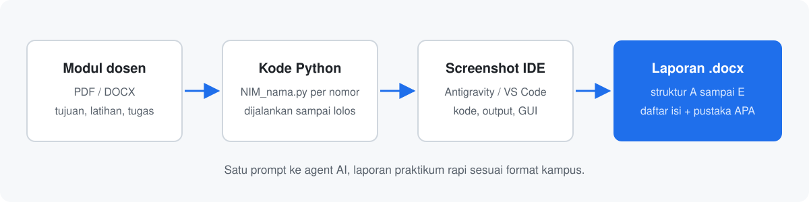

<div align="center">

[Bahasa Indonesia](../README.md) · **English**

# Laporan Praktikum

### An AI agent skill that turns a lecturer's lab module into a clean Word lab report.

[](../LICENSE)
[](../SKILL.md)
[](#requirements)
[](#requirements)

</div>

> [!IMPORTANT]
> The generated report is a writing aid. Read, understand, and run the code yourself before you hand it in, and
> follow your campus's academic integrity rules.

<div align="center">

</div>

## What it does

- Reads the lab module (PDF/DOCX): objectives, exercises, and assignment.
- Writes one Python file per exercise (`NIM_name.py`) and runs it until it passes.
- Takes screenshots of the code and terminal output in **Antigravity IDE** or **VS Code**, crops exactly the lines
  each exercise asks for, answers `input()` prompts automatically, and captures Tkinter windows.
- Builds the report from an old report used as a template: sections A to E (objectives, tools, theory, lab
  activities, assignment), a table of contents, and an APA bibliography checked against the original sources.
- Keeps the campus format: nested indents, every image exactly 10 cm wide with a 1 pt border, keep-with-next, and
  no stretched justified lines.

The report text is written in Indonesian, following the format used at STITEK Bontang.

## Install

```powershell
git clone https://github.com/bastiandoublen/laporan-praktikum
pip install python-docx Pillow PyMuPDF
```

Add the cloned folder to your agent’s skill directory according to its installation instructions.

Then attach the module and an old report, and ask your agent: "Work on this lab module using the attached report as
the template."

## Requirements

- Windows 10/11 with Microsoft Word
- Antigravity IDE or VS Code (with the `code` command)
- Python 3.10+ with `python-docx`, `Pillow`, `PyMuPDF`

## License

[MIT](../LICENSE)
